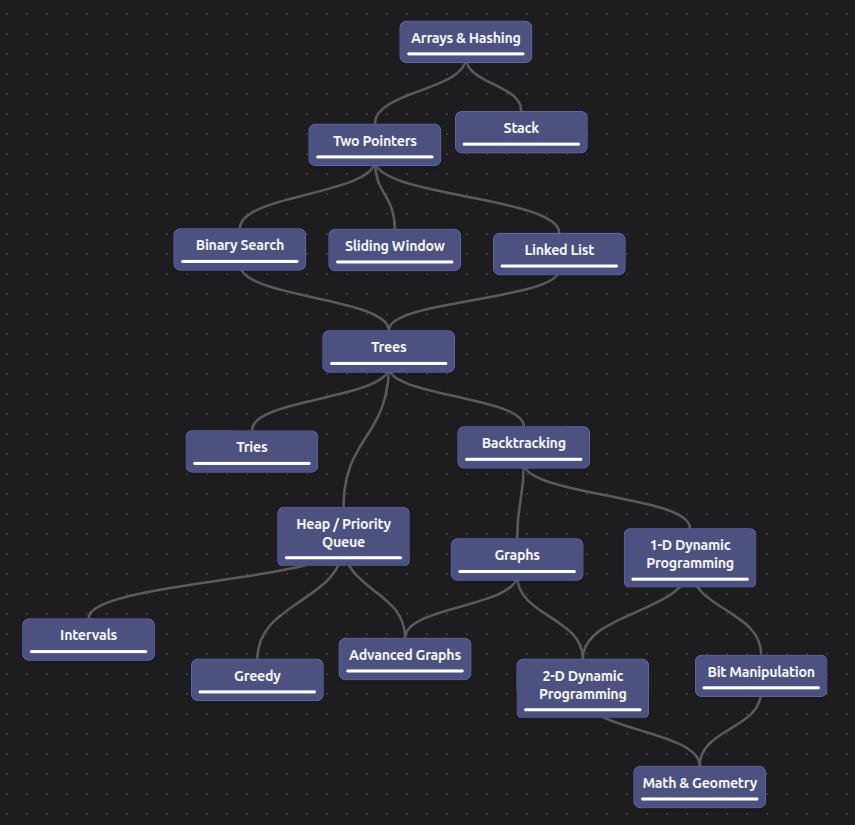

# 0 - Índice

- [0 - Índice](#0---índice)
- [1 - Roadmap](#1---roadmap)
- [2 - Arrays \& Hashing](#2---arrays--hashing)
  - [2.1 - Contains Duplicate](#21---contains-duplicate)
  - [2.2 - Valid Anagram](#22---valid-anagram)

# 1 - Roadmap



# 2 - Arrays & Hashing

## 2.1 - [Contains Duplicate](https://leetcode.com/problems/contains-duplicate/description/)

A gente precisa retornar se um array contem ou não números duplicados. O segredo é usar `set`s. A solução ótima que encontrei:

```kt
class ContainsDuplicate {
    fun containsDuplicate(nums: IntArray): Boolean {
        val tempSet = HashSet<Int>()
        for (num in nums) {
            if(!tempSet.add(num)) return true
        }
        return false
    }
}
```

---

Na solução documentada ele cita 3 maneiras, o brute force, que seria basicamente usar um for dentro de outro(Basic Array Traversal), uma com sorting, que também parece obvia, a gente usa um método pronto do kotlin para ordenar o array e ai ve se dois elementos seguidos são iguais, mas não adotei por sentir que ordenar iria fugir da proposta do exercício. E a terceita, que é a realizada, usando hash sets, a solução ótima.

- Basic Array Traversal
  - Complexidade de tempo: O(n^2)
  - Complexidade de memória: O(1)
- Sorting
  - Complexidade de tempo: O(n log n)
  - Complexidade de memória: O(1) ou O(n) dependendo do método de sorting
- Hash Sets
  - Complexidade de tempo: O(n)
  - Complexidade de memória: O(n)

## 2.2 - [Valid Anagram](https://leetcode.com/problems/valid-anagram/description/)
